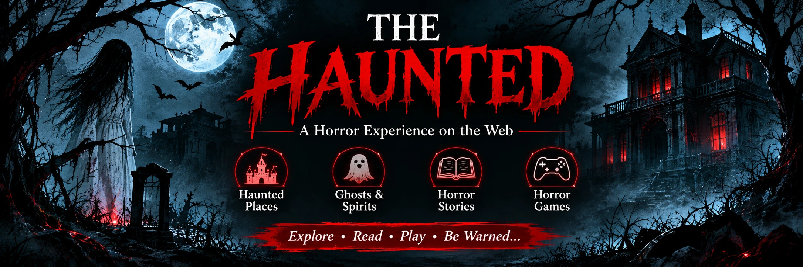

<p align="center">
  
</p>

<h1 align="center">💀 THE HAUNTED 👻</h1>

<h3 align="center">🩸 ENTER IF YOU DARE 🩸</h3>

<p align="center">
  <b>A Horror Experience on the Web</b>
</p>

<p align="center">
  Explore haunted places, discover paranormal mysteries,
  read terrifying stories, and challenge your courage.
</p>

<p align="center">
  <a href="https://the-haunted.vercel.app/">
    
  </a>
</p>

<p align="center">
  
  
  
  
</p>

---

## 🌐 LIVE WEBSITE

<p align="center">
  <a href="https://the-haunted.vercel.app/">
    <strong>👻 ENTER THE HAUNTED WORLD 👻</strong>
  </a>
</p>

🔗 **Live Link:** https://the-haunted.vercel.app/

---

## 🕯️ ABOUT THE PROJECT

**THE HAUNTED** is an immersive horror-themed website built using **React and Vite**.

Enter a dark world filled with mysterious locations, paranormal entities, terrifying stories, and interactive horror games.

This project combines atmospheric visuals, animations, background music, and sound effects to create an unforgettable horror experience.

> ⚠️ Once you enter, there's no guarantee you'll leave the same!

---

## 👻 FEATURES

### 🏚️ 1. HAUNTED PLACES

- Explore mysterious and reportedly haunted locations.
- Discover their histories, legends, and paranormal activities.
- View detailed information about each location.

### 📖 2. HORROR STORIES

- Explore terrifying horror stories.
- Open individual story details.
- Read comic-style horror stories.
- Navigate between comic pages.

### 🔮 3. PARANORMAL WORLD

- Discover ghosts and spirits.
- Explore haunted and cursed objects.
- Learn about paranormal legends and mysterious entities.
- Filter entities by category.

### 🩸 4. FEAR LAB

**Five interactive horror games. Are you brave enough to play?**

| 🎮 Game           | 💀 Challenge                                            |
| ----------------- | ------------------------------------------------------- |
| 👻 HAUNT ME       | Survive the countdown before the ghost appears.         |
| 👁️ DON'T BLINK    | Stay alert. Something is watching you.                  |
| 🔍 FIND THE GHOST | Find the hidden ghost in just 5 attempts.               |
| 🔐 ESCAPE ROOM    | Solve puzzles and escape before time runs out.          |
| 🧠 FEAR TEST      | Face terrifying scenarios and discover your fear level. |

### 🎵 5. HORROR ATMOSPHERE

- Dark horror-themed interface.
- Atmospheric background images.
- Animated visual effects.
- Website-wide ambient horror music.
- Game-specific sound effects and jump scares.
- Responsive design for desktop and mobile devices.

---

## 🛠️ TECH STACK

| Technology          | Purpose                                   |
| ------------------- | ----------------------------------------- |
| ⚛️ React            | Frontend development                      |
| ⚡ Vite             | Development server and build tool         |
| 🧭 React Router DOM | Page navigation                           |
| 🎨 CSS              | Styling, animations and responsive design |
| 💛 JavaScript       | Application logic                         |
| 🔊 HTML5 Audio      | Music and sound effects                   |
| ▲ Vercel            | Website deployment                        |

---

## 🚀 GETTING STARTED

Follow these steps to run the project locally.

### 📌 Prerequisites

Make sure you have installed:

- [Node.js](https://nodejs.org/)
- npm
- [Git](https://git-scm.com/)

### 1️⃣ Clone the Repository

```bash
git clone https://github.com/YOUR-USERNAME/the-haunted.git
```

### 2️⃣ Navigate to the Project

```bash
cd the-haunted
```

### 3️⃣ Install Dependencies

```bash
npm install
```

### 4️⃣ Start the Development Server

```bash
npm run dev
```

Open the local URL displayed in your terminal.

Usually:

```text
http://localhost:5173
```

🎉 You're inside THE HAUNTED!

---

## 📂 PROJECT STRUCTURE

```text
the-haunted/
│
├── public/
│   ├── images/
│   │   ├── background-images/
│   │   ├── characters/
│   │   ├── decorations/
│   │   ├── comics/
│   │   ├── haunted-places/
│   │   ├── paranormal/
│   │   └── fear-lab/
│   │
│   └── sounds/
│
├── src/
│   ├── components/
│   ├── data/
│   ├── features/
│   │   └── fear-lab/
│   ├── pages/
│   ├── styles/
│   ├── App.jsx
│   └── main.jsx
│
├── index.html
├── package.json
└── vite.config.js
```

---

## 🧭 WEBSITE ROUTES

| Route                      | Page                  |
| -------------------------- | --------------------- |
| `/`                        | 🏠 Home               |
| `/stories`                 | 📖 Horror Stories     |
| `/stories/:storyId`        | 📚 Story Details      |
| `/haunted-places`          | 🏚️ Haunted Places     |
| `/haunted-places/:placeId` | 🗺️ Place Details      |
| `/paranormal`              | 🔮 Paranormal         |
| `/paranormal/:id`          | 👻 Paranormal Details |
| `/fear-lab`                | 🩸 FEAR LAB           |
| `/fear-lab/haunt-me`       | 👻 HAUNT ME           |
| `/fear-lab/dont-blink`     | 👁️ DON'T BLINK        |
| `/fear-lab/find-the-ghost` | 🔍 FIND THE GHOST     |
| `/fear-lab/escape-room`    | 🔐 ESCAPE ROOM        |
| `/fear-lab/fear-test`      | 🧠 FEAR TEST          |

---

## 📦 PRODUCTION BUILD

Create an optimized production build:

```bash
npm run build
```

Preview the production build:

```bash
npm run preview
```

The generated production files will be available inside the `dist/` folder.

---

## 🌐 DEPLOYMENT

**THE HAUNTED** is deployed using [Vercel](https://vercel.com/).

### Deployment Settings

| Setting          | Value           |
| ---------------- | --------------- |
| Framework Preset | Vite            |
| Build Command    | `npm run build` |
| Output Directory | `dist`          |
| Install Command  | `npm install`   |

🔗 **Visit the deployed website:**  
https://the-haunted.vercel.app/

---

## 🔮 FUTURE PLANS

- 📖 More horror stories.
- 🏚️ More haunted locations.
- 👻 More paranormal entities.
- 🎮 New interactive horror games.
- 📚 More horror comics.
- 🕸️ More immersive horror experiences.

---

## 👨‍💻 DEVELOPER

Created with ❤️ and a little bit of fear.

---

<h2 align="center">🩸 ENTER IF YOU DARE 🩸</h2>

<p align="center">
  <i>"If you hear something behind you... DON'T LOOK BACK."</i>
</p>

<p align="center">
  💀 Thanks for visiting THE HAUNTED! 👻
</p>

<p align="center">
  <a href="https://the-haunted.vercel.app/">
    🌐 VISIT THE HAUNTED
  </a>
</p>
